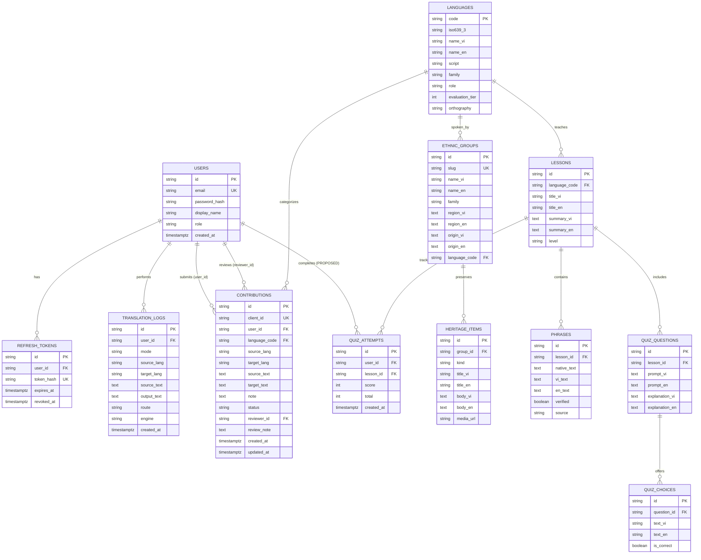

# 03. DATABASE REQUIREMENTS & SCHEMA DESIGN

> **Tài liệu:** Đặc tả Cơ sở dữ liệu PostgreSQL, Mô hình Quan hệ Thực thể (ERD) và Quy tắc Lưu trữ  
> **Phiên bản:** 1.0 (Phase 0 – Requirements & Technical Documentation)  
> **Đối chiếu:** `app/models.py`, `app/core/db.py`, `supabase/migrations/0001_init.sql`

---

## 1. Tổng quan Kiến trúc Cơ sở Dữ liệu

- **Hệ quản trị CSDL mục tiêu (Production)**: **PostgreSQL 15+** (triển khai trên **AWS RDS PostgreSQL** hoặc **Supabase PostgreSQL**).
- **Cơ sở dữ liệu phát triển & kiểm thử cục bộ (Local/Test)**: **SQLite 3** (`sqlite+aiosqlite:///./data/dev.db` hoặc `:memory:` với `PRAGMA foreign_keys=ON`).
- **ORM & Driver**: SQLAlchemy 2.0 (`DeclarativeBase`, `Mapped`, `mapped_column`, `AsyncSession`) kết hợp driver bất đồng bộ `asyncpg` (cho PostgreSQL) và `aiosqlite` (cho SQLite).
- **Quản lý Migration**:
  - Hiện trạng (`PARTIAL`): Đã có script SQL khởi tạo `supabase/migrations/0001_init.sql` và cơ chế tự tạo bảng `Base.metadata.create_all` khi khởi động (`app/core/db.py`), nhưng **chưa khởi tạo cấu hình Alembic** dù `alembic>=1.14` đã có trong `pyproject.toml`.
  - Yêu cầu hoàn thiện: Khởi tạo Alembic (`alembic.ini`, `alembic/env.py`) hỗ trợ async engine để quản lý lịch sử thay đổi schema trên AWS RDS PostgreSQL một cách an toàn.

---

## 2. Danh sách các Thực thể (Entities) hiện có

Hệ thống hiện có **10 bảng dữ liệu** đã được định nghĩa đồng bộ giữa `app/models.py` và `supabase/migrations/0001_init.sql`:

| STT | Tên bảng (Table) | Model Class (`app/models.py`) | Mô tả chức năng | Trạng thái |
| :-: | :--- | :--- | :--- | :---: |
| 1 | `users` | `User` | Lưu thông tin tài khoản người dùng và vai trò (`member`, `reviewer`, `admin`). | `VERIFIED` |
| 2 | `refresh_tokens` | `RefreshToken` | Lưu mã băm (`token_hash`) của Refresh Token phục vụ cơ chế xoay vòng và thu hồi token. | `VERIFIED` |
| 3 | `languages` | `Language` | Danh mục 7 ngôn ngữ (5 ngôn ngữ dân tộc thiểu số + Tiếng Việt + Tiếng Anh). | `VERIFIED` |
| 4 | `ethnic_groups` | `EthnicGroup` | Hồ sơ 5 dân tộc thiểu số (Tày, Ê Đê, Chăm, H'Mông, Jrai), vùng cư trú và nguồn gốc ngôn ngữ. | `VERIFIED` |
| 5 | `heritage_items` | `HeritageItem` | Các mục tư liệu di sản văn hóa (bài viết, hình ảnh, âm thanh, video) gắn với từng dân tộc. | `VERIFIED` |
| 6 | `lessons` | `Lesson` | Các bài học ngôn ngữ theo từng cấp độ (`basic`, ...). | `VERIFIED` |
| 7 | `phrases` | `Phrase` | Các câu/cụm từ giao tiếp mẫu song ngữ thuộc bài học (có cờ kiểm chứng `verified`). | `VERIFIED` |
| 8 | `quiz_questions` | `QuizQuestion` | Câu hỏi trắc nghiệm ôn tập thuộc từng bài học. | `VERIFIED` |
| 9 | `quiz_choices` | `QuizChoice` | Các phương án lựa chọn của câu hỏi trắc nghiệm (chứa đáp án `is_correct`). | `VERIFIED` |
| 10 | `translation_logs` | `TranslationLog` | Nhật ký sử dụng tính năng dịch thuật AI (văn bản, hình ảnh, giọng nói). | `VERIFIED` |
| 11 | `contributions` | `Contribution` | Dữ liệu cặp câu song ngữ do cộng đồng đóng góp và trạng thái kiểm duyệt. | `VERIFIED` |

*(Ghi chú: Trên PostgreSQL còn có thêm 1 View bảo mật là `quiz_choices_public` chỉ chọn `id, question_id, text_vi, text_en` để ẩn cột `is_correct`).*

---

## 3. Đặc tả Chi tiết Thuộc tính, Kiểu dữ liệu, Ràng buộc & Index

### 3.1. Bảng `users`
Lưu trữ thông tin định danh và phân quyền người dùng.

| Cột (Column) | Kiểu SQLAlchemy | Kiểu PostgreSQL | Null? | Mặc định | Ràng buộc / Index | Mô tả |
| :--- | :--- | :--- | :---: | :--- | :--- | :--- |
| `id` | `String(36)` | `text` | Không | `uuid4()` | **PK** | UUID định danh người dùng |
| `email` | `String(255)` | `text` | Không | - | **UNIQUE**, **INDEX** (`ix_users_email`) | Địa chỉ email (luôn lưu chữ thường) |
| `password_hash` | `String(255)` | `text` | Không | - | - | Chuỗi băm mật khẩu Argon2 |
| `display_name` | `String(120)` | `text` | Không | - | - | Tên hiển thị của người dùng |
| `role` | `String(16)` | `text` | Không | `'member'` | - | Vai trò: `'member'`, `'reviewer'`, `'admin'` |
| `created_at` | `DateTime(timezone=True)` | `timestamptz` | Không | - | - | Thời điểm tạo tài khoản (UTC) |

### 3.2. Bảng `refresh_tokens`
Quản lý vòng đời của JWT Refresh Token (xoay vòng 1 lần).

| Cột (Column) | Kiểu SQLAlchemy | Kiểu PostgreSQL | Null? | Mặc định | Ràng buộc / Index | Mô tả |
| :--- | :--- | :--- | :---: | :--- | :--- | :--- |
| `id` | `String(36)` | `text` | Không | `uuid4()` | **PK** | UUID bản ghi |
| `user_id` | `String(36)` | `text` | Không | - | **FK** -> `users.id` (`ON DELETE CASCADE`), **INDEX** | Chủ sở hữu token |
| `token_hash` | `String(64)` | `text` | Không | - | **UNIQUE** | Mã băm SHA-256 của trường `jti` trong JWT |
| `expires_at` | `DateTime(timezone=True)` | `timestamptz` | Không | - | - | Thời điểm hết hạn (mặc định +14 ngày) |
| `revoked_at` | `DateTime(timezone=True)` | `timestamptz` | Có | `NULL` | - | Thời điểm token bị thu hồi hoặc đã xoay vòng |

### 3.3. Bảng `languages`
Danh mục ngôn ngữ chuẩn.

| Cột (Column) | Kiểu SQLAlchemy | Kiểu PostgreSQL | Null? | Mặc định | Ràng buộc / Index | Mô tả |
| :--- | :--- | :--- | :---: | :--- | :--- | :--- |
| `code` | `String(16)` | `text` | Không | - | **PK** | Mã ngôn ngữ (`vi`, `en`, `tyz`, `rad`, `cjm`, `hmn`, `jra`) |
| `iso639_3` | `String(16)` | `text` | Không | - | - | Mã chuẩn quốc tế ISO 639-3 (`vie`, `eng`, `tyz`, ...) |
| `name_vi` | `String(120)` | `text` | Không | - | - | Tên ngôn ngữ bằng tiếng Việt |
| `name_en` | `String(120)` | `text` | Không | - | - | Tên ngôn ngữ bằng tiếng Anh |
| `script` | `String(32)` | `text` | Không | - | - | Hệ chữ viết (`Latn`, `Cham`) |
| `family` | `String(120)` | `text` | Không | - | - | Ngữ hệ (`Tai-Kadai`, `Austronesian, Chamic`, ...) |
| `role` | `String(16)` | `text` | Không | - | - | Vai trò (`pivot` hoặc `ethnic`) |
| `evaluation_tier` | `Integer` | `integer` | Không | - | - | Nhóm ưu tiên đánh giá (`0`, `1`, `2`) |
| `orthography` | `String(255)` | `text` | Không | - | - | Ghi chú quy tắc chính tả / chữ viết |

### 3.4. Bảng `ethnic_groups`
Thông tin các dân tộc thiểu số.

| Cột (Column) | Kiểu SQLAlchemy | Kiểu PostgreSQL | Null? | Mặc định | Ràng buộc / Index | Mô tả |
| :--- | :--- | :--- | :---: | :--- | :--- | :--- |
| `id` | `String(36)` | `text` | Không | - | **PK** | UUID (sinh cố định qua `uuid5` khi seed) |
| `slug` | `String(32)` | `text` | Không | - | **UNIQUE** | Định danh URL thân thiện (`tay`, `ede`, `cham`, `hmong`, `jrai`) |
| `name_vi` | `String(120)` | `text` | Không | - | - | Tên dân tộc (Tiếng Việt) |
| `name_en` | `String(120)` | `text` | Không | - | - | Tên dân tộc (Tiếng Anh) |
| `family` | `String(120)` | `text` | Không | - | - | Ngữ hệ |
| `region_vi` | `Text` | `text` | Không | - | - | Địa bàn cư trú chính (Tiếng Việt) |
| `region_en` | `Text` | `text` | Không | - | - | Địa bàn cư trú chính (Tiếng Anh) |
| `origin_vi` | `Text` | `text` | Không | - | - | Giới thiệu nguồn gốc và đặc điểm ngôn ngữ (Tiếng Việt) |
| `origin_en` | `Text` | `text` | Không | - | - | Giới thiệu nguồn gốc và đặc điểm ngôn ngữ (Tiếng Anh) |
| `language_code` | `String(16)` | `text` | Không | - | **FK** -> `languages.code` | Ngôn ngữ chính của dân tộc |

### 3.5. Bảng `heritage_items`
Tư liệu di sản văn hóa của từng dân tộc.

| Cột (Column) | Kiểu SQLAlchemy | Kiểu PostgreSQL | Null? | Mặc định | Ràng buộc / Index | Mô tả |
| :--- | :--- | :--- | :---: | :--- | :--- | :--- |
| `id` | `String(36)` | `text` | Không | `uuid4()` | **PK** | UUID mục di sản |
| `group_id` | `String(36)` | `text` | Không | - | **FK** -> `ethnic_groups.id` (`ON DELETE CASCADE`), **UQ(group_id, title_vi)** | Dân tộc sở hữu di sản |
| `kind` | `String(16)` | `text` | Không | - | - | Loại tư liệu (`article`, `image`, `video`, `audio`) |
| `title_vi` | `String(200)` | `text` | Không | - | **UQ(group_id, title_vi)** | Tiêu đề tiếng Việt |
| `title_en` | `String(200)` | `text` | Không | - | - | Tiêu đề tiếng Anh |
| `body_vi` | `Text` | `text` | Không | - | - | Nội dung mô tả tiếng Việt |
| `body_en` | `Text` | `text` | Không | - | - | Nội dung mô tả tiếng Anh |
| `media_url` | `String(500)` | `text` | Có | `NULL` | - | Đường dẫn URL tới file ảnh/video/audio (trên S3/CDN) |

### 3.6. Bảng `lessons`
Bài học ngôn ngữ.

| Cột (Column) | Kiểu SQLAlchemy | Kiểu PostgreSQL | Null? | Mặc định | Ràng buộc / Index | Mô tả |
| :--- | :--- | :--- | :---: | :--- | :--- | :--- |
| `id` | `String(36)` | `text` | Không | - | **PK** | UUID bài học (`uuid5` theo dân tộc khi seed) |
| `language_code` | `String(16)` | `text` | Không | - | **FK** -> `languages.code` | Ngôn ngữ của bài học |
| `title_vi` | `String(200)` | `text` | Không | - | - | Tên bài học (Tiếng Việt) |
| `title_en` | `String(200)` | `text` | Không | - | - | Tên bài học (Tiếng Anh) |
| `summary_vi` | `Text` | `text` | Không | - | - | Tóm tắt nội dung bài học (Tiếng Việt) |
| `summary_en` | `Text` | `text` | Không | - | - | Tóm tắt nội dung bài học (Tiếng Anh) |
| `level` | `String(16)` | `text` | Không | `'basic'` | - | Cấp độ bài học (`basic`, `intermediate`, `advanced`) |

### 3.7. Bảng `phrases`
Các câu/từ vựng giao tiếp mẫu trong bài học.

| Cột (Column) | Kiểu SQLAlchemy | Kiểu PostgreSQL | Null? | Mặc định | Ràng buộc / Index | Mô tả |
| :--- | :--- | :--- | :---: | :--- | :--- | :--- |
| `id` | `String(36)` | `text` | Không | `uuid4()` | **PK** | UUID câu mẫu |
| `lesson_id` | `String(36)` | `text` | Không | - | **FK** -> `lessons.id` (`ON DELETE CASCADE`) | Thuộc bài học nào |
| `native_text` | `Text` | `text` | Không | - | - | Câu gốc bằng ngôn ngữ dân tộc |
| `vi_text` | `Text` | `text` | Không | - | - | Nghĩa tiếng Việt |
| `en_text` | `Text` | `text` | Không | - | - | Nghĩa tiếng Anh |
| `verified` | `Boolean` | `boolean` | Không | `False` | - | Cờ xác nhận đã được người bản ngữ/chuyên gia kiểm chứng |
| `source` | `String(255)` | `text` | Có | `NULL` | - | Nguồn trích dẫn học liệu |

### 3.8. Bảng `quiz_questions` & `quiz_choices`
Ngân hàng câu hỏi và lựa chọn trắc nghiệm của bài học.

**Bảng `quiz_questions`:**

| Cột (Column) | Kiểu SQLAlchemy | Null? | Ràng buộc / Index | Mô tả |
| :--- | :--- | :---: | :--- | :--- |
| `id` | `String(36)` | Không | **PK** | UUID câu hỏi |
| `lesson_id` | `String(36)` | Không | **FK** -> `lessons.id` (`ON DELETE CASCADE`) | Bài học chứa câu hỏi |
| `prompt_vi` | `Text` | Không | - | Nội dung câu hỏi (Tiếng Việt) |
| `prompt_en` | `Text` | Không | - | Nội dung câu hỏi (Tiếng Anh) |
| `explanation_vi` | `Text` | Không | - | Giải thích đáp án sau khi nộp bài (Tiếng Việt) |
| `explanation_en` | `Text` | Không | - | Giải thích đáp án sau khi nộp bài (Tiếng Anh) |

**Bảng `quiz_choices`:**

| Cột (Column) | Kiểu SQLAlchemy | Null? | Ràng buộc / Index | Mô tả |
| :--- | :--- | :---: | :--- | :--- |
| `id` | `String(36)` | Không | **PK** | UUID lựa chọn |
| `question_id` | `String(36)` | Không | **FK** -> `quiz_questions.id` (`ON DELETE CASCADE`) | Thuộc câu hỏi nào |
| `text_vi` | `String(255)` | Không | - | Nội dung phương án (Tiếng Việt) |
| `text_en` | `String(255)` | Không | - | Nội dung phương án (Tiếng Anh) |
| `is_correct` | `Boolean` | Không | Mặc định `False` | Đáp án đúng hay sai (**Không bao giờ gửi xuống client khi lấy đề**) |

### 3.9. Bảng `translation_logs`
Lưu lịch sử các yêu cầu dịch thuật AI.

| Cột (Column) | Kiểu SQLAlchemy | Null? | Ràng buộc / Index | Mô tả |
| :--- | :--- | :---: | :--- | :--- |
| `id` | `String(36)` | Không | **PK** | UUID bản ghi log |
| `user_id` | `String(36)` | Có | **FK** -> `users.id`, **INDEX** | Người dùng thực hiện dịch (`NULL` nếu khách vãng lai) |
| `mode` | `String(16)` | Không | - | Phương thức dịch: `'text'`, `'image'`, `'speech'` |
| `source_lang` | `String(16)` | Không | - | Mã ngôn ngữ nguồn thực tế |
| `target_lang` | `String(16)` | Không | - | Mã ngôn ngữ đích |
| `source_text` | `Text` | Không | - | Văn bản đầu vào hoặc nhận diện được (tối đa 4000 ký tự) |
| `output_text` | `Text` | Không | - | Văn bản kết quả dịch (tối đa 4000 ký tự) |
| `route` | `String(32)` | Không | - | Tuyến dịch (`direct`, `pivot`, `ocr`, `asr`, ...) |
| `engine` | `String(64)` | Không | - | Tên engine/model ML xử lý |
| `created_at` | `DateTime(timezone=True)` | Không | - | Thời gian thực hiện (UTC) |

### 3.10. Bảng `contributions`
Quản lý dữ liệu đóng góp từ cộng đồng và quy trình duyệt.

| Cột (Column) | Kiểu SQLAlchemy | Null? | Ràng buộc / Index | Mô tả |
| :--- | :--- | :---: | :--- | :--- |
| `id` | `String(36)` | Không | **PK** | UUID đóng góp trên server |
| `client_id` | `String(64)` | Không | **UNIQUE**, **INDEX** | Định danh duy nhất sinh từ thiết bị client (dùng cho idempotent sync) |
| `user_id` | `String(36)` | Không | **FK** -> `users.id`, **INDEX** | Người gửi đóng góp |
| `language_code` | `String(16)` | Không | **FK** -> `languages.code` | Ngôn ngữ dân tộc chính của câu đóng góp |
| `source_lang` | `String(16)` | Không | - | Ngôn ngữ của `source_text` |
| `target_lang` | `String(16)` | Không | - | Ngôn ngữ của `target_text` |
| `source_text` | `Text` | Không | - | Câu nguồn (đã chuẩn hóa khoảng trắng) |
| `target_text` | `Text` | Không | - | Câu đích (đã chuẩn hóa khoảng trắng) |
| `note` | `Text` | Có | - | Ghi chú ngữ cảnh / nguồn tham khảo của người đóng góp |
| `status` | `String(16)` | Không | Mặc định `'pending'`, **INDEX** | Trạng thái duyệt: `'pending'`, `'approved'`, `'rejected'` |
| `reviewer_id` | `String(36)` | Có | **FK** -> `users.id` | Người kiểm duyệt thực hiện phê duyệt/từ chối |
| `review_note` | `Text` | Có | - | Nhận xét hoặc lý do từ chối của người kiểm duyệt |
| `created_at` | `DateTime(timezone=True)` | Không | - | Thời điểm tạo |
| `updated_at` | `DateTime(timezone=True)` | Không | - | Thời điểm cập nhật/duyệt gần nhất |

---

## 4. Sơ đồ Quan hệ Thực thể (Entity-Relationship Diagram - ERD)

---

## 5. Đánh giá Schema hiện tại & Đề xuất Mở rộng (`PROPOSED`)

### 5.1. Bảng đề xuất bổ sung: `quiz_attempts` (Lưu lịch sử & tiến độ học tập)
- **Lý do**: Yêu cầu mục 4.5 & Mục 5 yêu cầu *"Lưu kết quả học tập"* và *"Theo dõi tiến độ học tập (Learning Progress)"*, trong khi hiện tại `POST /v1/lessons/{lesson_id}/quiz` chưa lưu vào DB.
- **Thiết kế bảng `quiz_attempts`** (`PROPOSED`):
  - `id`: `String(36)` PK (`uuid4`)
  - `user_id`: `String(36)` FK -> `users.id` (`ON DELETE CASCADE`, `INDEX`)
  - `lesson_id`: `String(36)` FK -> `lessons.id` (`ON DELETE CASCADE`, `INDEX`)
  - `score`: `Integer` (Số câu trả lời đúng)
  - `total`: `Integer` (Tổng số câu hỏi trong bài)
  - `created_at`: `DateTime(timezone=True)`
- **Tính tương thích**: Hoàn toàn không sửa đổi các bảng hiện có, không ảnh hưởng tới `POST /v1/lessons/{lesson_id}/quiz` đối với khách chưa đăng nhập (nếu có `user` đăng nhập thì tự động ghi nhận kết quả).

### 5.2. Các Index cần bổ sung trong Migration (`PROPOSED`)
Khi đối chiếu giữa `app/models.py` và `supabase/migrations/0001_init.sql`:
1. Trong `0001_init.sql` chưa có các lệnh `CREATE INDEX` tường minh cho `refresh_tokens(user_id)`, `translation_logs(user_id)`, `contributions(user_id)`, `contributions(status)` dù trong `app/models.py` đã khai báo `index=True`.
2. Cần bổ sung thêm index cho các khóa ngoại thường xuyên truy vấn:
   - `ix_ethnic_groups_language_code` trên `ethnic_groups(language_code)`
   - `ix_lessons_language_code` trên `lessons(language_code)`
   - `ix_contributions_language_code` trên `contributions(language_code)`
   - `ix_translation_logs_created_at` trên `translation_logs(created_at)`

---

## 6. Quy tắc Lưu trữ và Quản lý Dữ liệu

1. **Không lưu trữ tệp nhị phân lớn (BLOB) trong PostgreSQL**:
   - Ảnh di sản, video giới thiệu, âm thanh mẫu chỉ lưu đường dẫn (`media_url`) trong PostgreSQL; tệp vật lý được lưu trên Object Storage (AWS S3 / CloudFront hoặc Supabase Storage).
   - Ảnh OCR và âm thanh ASR do người dùng gửi lên để dịch chỉ được đọc trong bộ nhớ đệm (với giới hạn nghiêm ngặt 8 MB / 20 MB), chuyển tiếp sang ML Service rồi giải phóng ngay, chỉ lưu văn bản (`source_text`, `output_text`) vào `translation_logs`.
2. **Quản lý Múi giờ (Timezone)**:
   - Mọi cột thời gian (`created_at`, `updated_at`, `expires_at`, `revoked_at`) bắt buộc dùng kiểu `DateTime(timezone=True)` (`timestamptz` trong PostgreSQL) và ghi theo chuẩn `UTC` (`datetime.now(timezone.utc)`).
3. **Tính toàn vẹn Tham chiếu (Referential Integrity)**:
   - Khi xóa `EthnicGroup` -> tự động xóa `HeritageItem` liên kết (`ON DELETE CASCADE`).
   - Khi xóa `Lesson` -> tự động xóa `Phrase`, `QuizQuestion` và `QuizChoice` liên kết (`ON DELETE CASCADE`).
   - Không cho phép xóa `Language` nếu đang có `EthnicGroup`, `Lesson` hoặc `Contribution` tham chiếu tới.
4. **Dữ liệu Gốc (Seed Data Idempotency)**:
   - Quá trình chạy hàm `seed()` (`app/seed.py`) sử dụng UUID định danh xác định (`uuid.uuid5`) cho `EthnicGroup`, `Lesson`, `QuizQuestion`, `QuizChoice` và kiểm tra sự tồn tại trước khi thêm mới, đảm bảo chạy lại nhiều lần không sinh dữ liệu rác hoặc trùng lặp.

