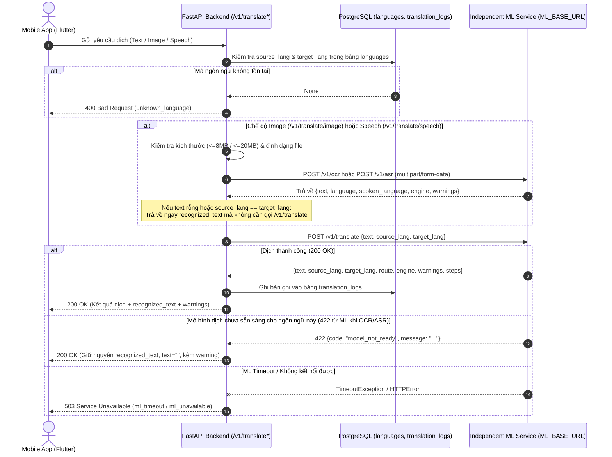

# 05. AI INTEGRATION REQUIREMENTS

> **Tài liệu:** Kiến trúc Tích hợp Dịch vụ AI/ML (Text Translation, Image OCR, Voice ASR)  
> **Phiên bản:** 1.0 (Phase 0 – Requirements & Technical Documentation)  
> **Đối chiếu:** `app/integrations/ml_client.py`, `app/routers/translate.py`, `shared/languages.json`, `tests/test_api.py`

---

## 1. Kiến trúc Kết nối giữa Backend và ML Service

Backend **không nhúng trực tiếp các mô hình học sâu (NLLB, Whisper, OCR)** vào trong tiến trình FastAPI của API Server để tránh nghẽn CPU/GPU và cho phép mở rộng độc lập. Thay vào đó, Backend giao tiếp với một **ML Service độc lập** qua giao thức HTTP/JSON và `multipart/form-data` thông qua lớp tích hợp `MlClient` (`app/integrations/ml_client.py`).



---

## 2. Trạng thái Hỗ trợ AI theo Ngôn ngữ (`shared/languages.json`)

Dữ liệu cấu hình trong `shared/languages.json` định nghĩa rõ năng lực xử lý của từng ngôn ngữ đối với 3 tác vụ **MT (Machine Translation)**, **ASR (Automatic Speech Recognition)** và **OCR (Optical Character Recognition)**:

| Mã (`code`) | Ngôn ngữ | `nllb_code` | `mt_status` | `asr_status` | `ocr_status` | Đặc điểm xử lý AI |
| :--- | :--- | :--- | :--- | :--- | :--- | :--- |
| `vi` | Tiếng Việt | `vie_Latn` | `high_resource` | `whisper` | `latin` | Ngôn ngữ cầu nối (pivot) chính giữa các ngôn ngữ dân tộc và tiếng Anh. |
| `en` | Tiếng Anh | `eng_Latn` | `high_resource` | `whisper` | `latin` | Ngôn ngữ cầu nối quốc tế. |
| `tyz` | Tiếng Tày | `null` | `public_bitext` | `collect` | `latin` | Có dữ liệu song ngữ Tày–Việt công khai, ưu tiên fine-tune dịch máy giai đoạn 1. |
| `rad` | Tiếng Ê Đê | `null` | `public_bitext` | `collect` | `latin` | Chữ Latin ổn định, có corpus song ngữ Ê Đê–Việt phục vụ fine-tune MT. |
| `cjm` | Tiếng Chăm | `null` | `scarce_bitext` | `collect` | `cham_script` | Tách biệt OCR chữ truyền thống Akhar Thrah (`cham_script`) và dịch văn bản Latin. |
| `hmn` | Tiếng H'Mông | `null` | `speech_text_pairs` | `public_audio` | `latin` | Ngôn ngữ ưu tiên số 1 cho nhánh nhận diện giọng nói (ASR) từ nguồn audio VOV. |
| `jra` | Tiếng Jrai | `null` | `prior_smt` | `collect` | `latin` | Tận dụng chuyển giao học sâu (transfer learning) từ tiếng Ê Đê cùng nhóm Chamic. |

---

## 3. Đặc tả Giao tiếp giữa Backend và ML Service

### 3.1. Cấu hình Kết nối (`MlClient`)
- **Biến môi trường**:
  - `ML_BASE_URL` (mặc định `http://127.0.0.1:8100`): Địa chỉ gốc của ML Service.
  - `ML_TEXT_TIMEOUT` (hiện tại hằng số `TEXT_TIMEOUT = 60` giây, đề xuất đưa vào `Settings`).
  - `ML_FILE_TIMEOUT` (hiện tại hằng số `FILE_TIMEOUT = 180` giây, đề xuất đưa vào `Settings`).
  - `ML_API_KEY` (`PROPOSED`): Khóa xác thực nội bộ (Header `X-API-Key` hoặc `Authorization`) khi Backend trên EC2 gọi sang ML Service.
- **Dependency Injection**:
  - Các router trong `app/routers/translate.py` nhận instance thông qua `Depends(get_ml_client)`.
  - Cho phép thay thế dễ dàng bằng Mock/Fake provider trong quá trình kiểm thử tự động (`app.dependency_overrides[get_ml_client] = ...`).

---

### 3.2. Tác vụ 1: Dịch Văn bản (`POST /v1/translate` trên ML Service)
- **Request từ Backend sang ML Service**:
  ```json
  {
    "text": "Xin chào",
    "source_lang": "vi",
    "target_lang": "tyz"
  }
  ```
- **Response từ ML Service về Backend**:
  ```json
  {
    "text": "Slương",
    "source_lang": "vi",
    "target_lang": "tyz",
    "detected_lang": "vi",
    "route": "direct",
    "engine": "nllb-200-distilled",
    "warnings": [],
    "steps": []
  }
  ```

---

### 3.3. Tác vụ 2: Nhận diện Văn bản từ Hình ảnh (`POST /v1/ocr` trên ML Service)
- **Kiểm tra đầu vào tại Backend**:
  - Giới hạn kích thước: `MAX_BYTES = 8 * 1024 * 1024` (8 MB). Đọc tối đa `MAX_BYTES + 1` byte để phát hiện vượt ngưỡng mà không làm tràn bộ nhớ RAM.
  - Nếu vượt quá 8 MB -> trả về ngay `413 Payload Too Large` (`code="file_too_large"`).
- **Request từ Backend sang ML Service**:
  - `multipart/form-data` với trường `file=(filename, content, content_type)`.
- **Response từ ML Service về Backend**:
  ```json
  {
    "text": "xin chào",
    "language": "vi",
    "engine": "vietocr",
    "warnings": []
  }
  ```
- **Quy tắc xử lý hậu kỳ (`_translate_recognized` trong `app/routers/translate.py`)** (`VERIFIED`):
  1. Nếu `text` rỗng sau khi `.strip()`: Trả về ngay `text=""`, `recognized_text=""` kèm `warnings` từ OCR mà không gọi `/v1/translate`.
  2. Nếu OCR phát hiện ngôn ngữ của chữ (`recognized["language"]`), cập nhật `source_lang` theo ngôn ngữ đó.
  3. Nếu `source_lang == target_lang`: Không cần gọi dịch máy, gán `result["text"] = text`, ghi log và trả kết quả.
  4. Nếu gọi `ml.translate` bị lỗi `422` (chưa có mô hình dịch cho cặp ngôn ngữ này): **Không ném lỗi 422 ra ngoài** mà vẫn trả về `200 OK` với `recognized_text = text`, `text = ""` và nối thông báo lỗi vào danh sách `warnings`.

---

### 3.4. Tác vụ 3: Nhận diện Giọng nói (`POST /v1/asr` trên ML Service)
- **Kiểm tra đầu vào tại Backend**:
  - Giới hạn kích thước: `MAX_AUDIO_BYTES = 20 * 1024 * 1024` (20 MB).
  - Nếu vượt quá 20 MB -> trả về ngay `413 Payload Too Large` (`code="file_too_large"`).
- **Request từ Backend sang ML Service**:
  - `multipart/form-data` với trường `file=(filename, content, content_type)`.
- **Response từ ML Service về Backend**:
  ```json
  {
    "text": "tôi về nhà",
    "engine": "whisper-hmong-vi",
    "language": "vi",
    "spoken_language": "hmn",
    "warnings": ["Dịch máy."]
  }
  ```
- **Quy tắc xử lý đặc biệt cho Speech-to-Text Translation (`VERIFIED`)**:
  - Một số checkpoint ASR (ví dụ mô hình huấn luyện trên dữ liệu phát thanh H'Mông–Việt) nghe âm thanh tiếng H'Mông (`spoken_language = "hmn"`) nhưng xuất ra văn bản đã là tiếng Việt (`language = "vi"`).
  - Hàm `_translate_recognized` kiểm tra:
    - Nếu người dùng chọn `source_lang` khác `"auto"` và khác `spoken_language`, hệ thống thêm cảnh báo: `"Mô hình giọng nói chỉ nghe được {spoken}, không phải {source_lang}."`
    - Sau đó gán `source_lang = recognized["language"]` (ngôn ngữ của văn bản đầu ra ASR).
    - Nếu `target_lang == "vi"` (trùng với ngôn ngữ văn bản ASR xuất ra), hệ thống trả thẳng văn bản tiếng Việt đó mà không gọi dịch lần hai; nếu `target_lang == "en"`, hệ thống gọi dịch từ `"vi"` sang `"en"`.

---

## 4. Xử lý Lỗi, Timeout và Logging

### 4.1. Ánh xạ Mã lỗi từ ML Service sang Backend HTTP Status
Trong hàm `_ml_error(exc: MlError)` (`app/routers/translate.py`):
- Nếu `exc.status == 400` -> Trả về HTTP `400 Bad Request` kèm `exc.payload`.
- Nếu `exc.status == 422` -> Trả về HTTP `422 Unprocessable Entity` kèm `exc.payload` (đối với dịch văn bản trực tiếp).
- Mọi mã lỗi khác (`500`, `502`, `503`, `504` hoặc lỗi kết nối/timeout) -> Chuẩn hóa về HTTP `503 Service Unavailable`.

### 4.2. Nhật ký Dịch thuật (`TranslationLog`) và Thời gian Xử lý
- Mỗi yêu cầu dịch thành công được ghi vào bảng `translation_logs` qua hàm `_log()`:
  - Lưu `user_id` (nếu có Bearer token hợp lệ) hoặc `None` (nếu khách vãng lai).
  - Lưu `mode` (`"text"`, `"image"`, `"speech"`), `source_lang`, `target_lang`, `source_text` (tối đa 4000 ký tự), `output_text` (tối đa 4000 ký tự), `route`, `engine`, `created_at`.
- **Yêu cầu bổ sung (`PROPOSED` cho Phase 4)**:
  - Đo thời gian phản hồi (`latency_ms`) bằng `time.perf_counter()` trong `MlClient._post` và ghi log cấu trúc (`logger.info`) để giám sát hiệu năng ML Service mà không ghi nội dung nhạy cảm của người dùng ra stdout.

