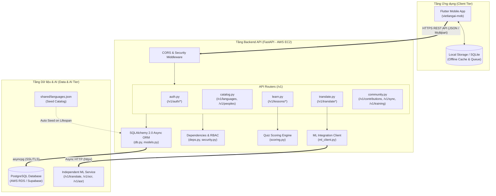
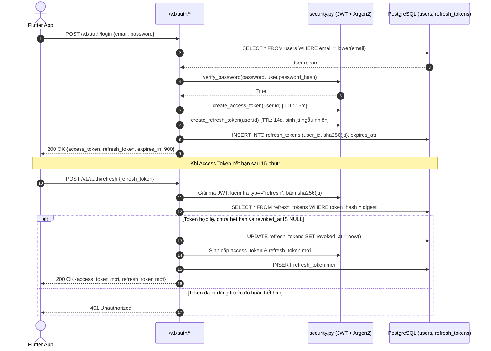
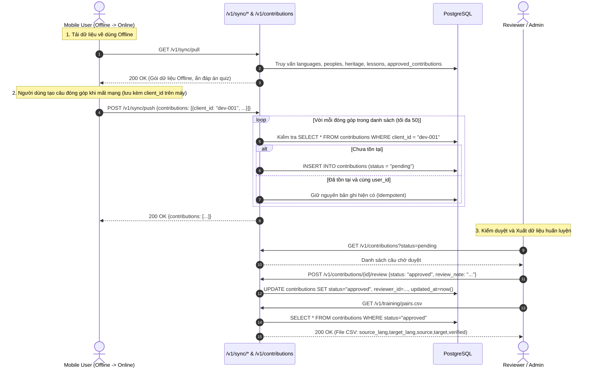
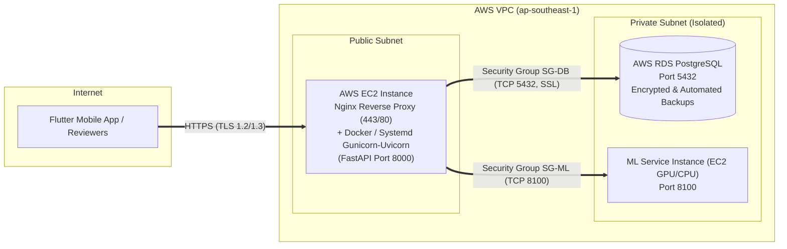

# 06. SYSTEM ARCHITECTURE & AWS DEPLOYMENT DESIGN

> **Tài liệu:** Kiến trúc Hệ thống Backend, Luồng Dữ liệu (DFD) và Thiết kế Hạ tầng AWS EC2 + RDS PostgreSQL  
> **Phiên bản:** 1.0 (Phase 0 – Requirements & Technical Documentation)

---

## 1. Kiến trúc Phân tầng Backend (Backend Layered Architecture)

Hệ thống Backend `vietlangai-backend` được xây dựng trên nền tảng **Python 3.11+ & FastAPI** với mô hình lập trình bất đồng bộ (`async/await`) xuyên suốt từ tầng HTTP Router xuống tầng Database (`SQLAlchemy AsyncSession`) và tầng tích hợp AI (`httpx.AsyncClient`).

### 1.1. Cấu trúc Thư mục Hiện tại và Định hướng Hoàn thiện

```text
vietlangai-backend/
├── alembic/                      # [PROPOSED - Phase 2] Quản lý Database Migrations
│   ├── versions/                 # Các phiên bản migration
│   └── env.py                    # Cấu hình chạy migration với AsyncEngine
├── alembic.ini                   # [PROPOSED - Phase 2] File cấu hình Alembic
├── app/
│   ├── core/                     # Hạ tầng cốt lõi (Configuration, DB, Security, Exceptions)
│   │   ├── config.py             # [VERIFIED] Quản lý biến môi trường qua Pydantic Settings
│   │   ├── db.py                 # [VERIFIED] Khởi tạo AsyncEngine & AsyncSession
│   │   ├── deps.py               # [VERIFIED] Dependency Injection (get_db, get_current_user)
│   │   ├── security.py           # [VERIFIED] Argon2 password hashing & JWT encode/decode
│   │   └── exceptions.py         # [PROPOSED - Phase 2] Global Exception Handlers thống nhất
│   ├── integrations/             # Tích hợp dịch vụ bên ngoài
│   │   └── ml_client.py          # [VERIFIED] HTTP Client bất đồng bộ kết nối ML Service
│   ├── routers/                  # Tầng điều phối HTTP Endpoints (/v1/*)
│   │   ├── auth.py               # [VERIFIED/PARTIAL] Đăng ký, đăng nhập, refresh, logout, me
│   │   ├── catalog.py            # [VERIFIED/PARTIAL] Ngôn ngữ, dân tộc, di sản văn hóa
│   │   ├── community.py          # [VERIFIED/PARTIAL] Đóng góp, kiểm duyệt, sync, CSV export
│   │   ├── learn.py              # [VERIFIED/PARTIAL] Bài học, câu mẫu, câu hỏi & chấm quiz
│   │   └── translate.py          # [VERIFIED/PARTIAL] Dịch văn bản, OCR ảnh, ASR giọng nói
│   ├── main.py                   # [VERIFIED] Khởi tạo ứng dụng FastAPI, Lifespan, CORS, /health
│   ├── models.py                 # [VERIFIED] Định nghĩa ORM Models (SQLAlchemy 2.0)
│   ├── paths.py                  # [VERIFIED] Truy xuất đường dẫn shared/languages.json
│   ├── scoring.py                # [VERIFIED] Logic chấm điểm bài trắc nghiệm
│   └── seed.py                   # [VERIFIED] Khởi tạo dữ liệu gốc idempotent
├── docs/                         # [PHASE 0] Bộ tài liệu Requirements & Architecture
├── shared/
│   └── languages.json            # [VERIFIED] Dữ liệu gốc 7 ngôn ngữ, 5 dân tộc, 5 di sản
├── supabase/
│   └── migrations/0001_init.sql  # [VERIFIED] DDL SQL khởi tạo bảng & chính sách RLS
├── tests/                        # [VERIFIED] Bộ kiểm thử tự động Pytest
│   ├── conftest.py
│   ├── test_api.py
│   └── test_scoring.py
├── .env.example                  # [PARTIAL] Mẫu cấu hình biến môi trường
├── Dockerfile                    # [VERIFIED] Đóng gói container Python 3.11-slim
└── pyproject.toml                # [VERIFIED] Khai báo dependencies và cấu hình pytest
```

---

## 2. Sơ đồ Thành phần Hệ thống (Component Diagram)



---

## 3. Các Luồng Xử lý Chính (Key System Flows)

### 3.1. Luồng Xác thực & Xoay vòng Refresh Token (Authentication Flow)



---

### 3.2. Luồng Đồng bộ Ngoại tuyến & Kiểm duyệt Cộng đồng (Offline Sync & Moderation Flow)



---

## 4. Kiến trúc Triển khai AWS EC2 & AWS RDS PostgreSQL

Hệ thống hướng tới triển khai Production trên hạ tầng **AWS VPC** đảm bảo tính bảo mật mạng và khả năng phục hồi dữ liệu:



### 4.1. Thiết kế Bảo mật Hạ tầng AWS
1. **Phân tách Subnet**:
   - **AWS EC2 (Backend API)** đặt tại Public Subnet, chỉ mở cổng `80` (chuyển hướng HTTPS) và `443` (HTTPS qua Nginx/Certbot hoặc ALB) ra Internet; cổng `22` (SSH) chỉ giới hạn cho IP quản trị hoặc dùng AWS Systems Manager Session Manager.
   - **AWS RDS PostgreSQL** đặt tại **Private Subnet** (`Publicly Accessible = No`).
2. **Thiết kế Security Groups**:
   - `sg-vietlangai-ec2`: Inbound `443/tcp` từ `0.0.0.0/0`; Outbound tới RDS và ML Service.
   - `sg-vietlangai-rds`: Inbound `5432/tcp` **chỉ cho phép nguồn là `sg-vietlangai-ec2`**, từ chối mọi kết nối trực tiếp từ Internet.
3. **Kết nối Cơ sở dữ liệu (`app/core/db.py`)**:
   - Sử dụng biến môi trường `DATABASE_URL=postgresql+asyncpg://<user>:<password>@<rds-endpoint>:5432/<dbname>`.
   - Kết nối mã hóa SSL (`ssl="require"`). Lưu ý: Hiện tại `app/core/db.py` đang đặt cứng `statement_cache_size: 0` để phục vụ Supabase Transaction Pooler; khi kết nối trực tiếp tới AWS RDS PostgreSQL (không qua PgBouncer transaction mode), có thể giữ `statement_cache_size: 0` (vẫn tương thích 100% với RDS) hoặc cho phép cấu hình qua biến môi trường.
4. **Sao lưu và Phục hồi (Backup & Recovery)**:
   - Kích hoạt **Automated Backups** trên AWS RDS (retention tối thiểu 7 ngày) và chụp **Final Snapshot** trước khi thực hiện bất kỳ thao tác nâng cấp schema lớn nào bằng Alembic.

