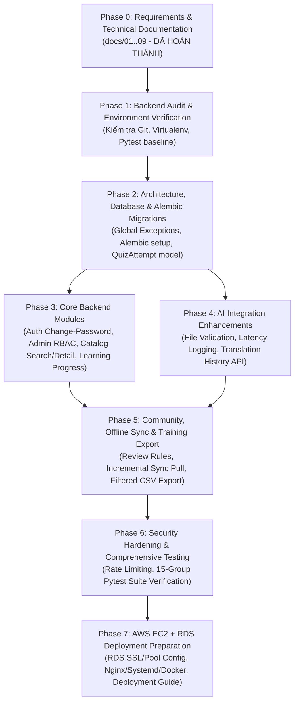

# 09. IMPLEMENTATION ROADMAP & RISK ANALYSIS

> **Tài liệu:** Lộ trình Triển khai theo Giai đoạn (Phased Roadmap), Phân tích Rủi ro Kỹ thuật và Tiêu chí Nghiệm thu  
> **Phiên bản:** 1.0 (Phase 0 – Requirements & Technical Documentation)

---

## 1. Tổng hợp các Vấn đề & Rủi ro Kỹ thuật Phát hiện qua Kiểm tra Code

Qua quá trình rà soát toàn bộ mã nguồn `vietlangai-backend` ở Phase 0, dưới đây là các vấn đề kỹ thuật cần giải quyết theo mức độ ưu tiên:

| Mã Vấn đề | Mức độ | Phân hệ | Mô tả chi tiết vấn đề | Hướng xử lý đề xuất |
| :--- | :---: | :--- | :--- | :--- |
| **ISS-01** | **Cao** | Database / Migration | Đã khai báo `alembic>=1.14` trong `pyproject.toml` nhưng chưa khởi tạo cấu hình Alembic (`alembic.ini`, `alembic/env.py`). Hiện đang dùng `Base.metadata.create_all` khi khởi động app, không thể quản lý nâng cấp schema an toàn trên AWS RDS PostgreSQL. | Khởi tạo Alembic hỗ trợ Async SQLAlchemy và tạo migration cơ sở (`0001_initial_schema`) khớp với các bảng hiện có. |
| **ISS-02** | **Cao** | Security / Auth & Seed | `app/seed.py` tự động tạo tài khoản `demo@ngonsacviet.example.com` với quyền `reviewer` và mật khẩu mặc định `"Demo1234"` khi `AUTO_SEED=true`. Trên môi trường Production, đây là lỗ hổng leo thang đặc quyền nếu không kiểm soát. | Tách biến cấu hình `SEED_DEMO_USER` hoặc kiểm tra môi trường `APP_ENV` để đảm bảo an toàn trên Production mà vẫn giữ nguyên hành vi cho môi trường dev/test. |
| **ISS-03** | **Trung bình** | Authorization (RBAC) | Hàm `_reviewer` trong `app/routers/community.py` kiểm tra cứng `user.role != "reviewer"`, khiến tài khoản có vai trò `admin` bị từ chối (`403 Forbidden`). Ngoài ra chưa chặn người dùng tự duyệt đóng góp của chính mình (khi không phải `admin`/demo). | Cho phép `user.role in ("reviewer", "admin")` và bổ sung kiểm tra chống tự duyệt hợp lý. |
| **ISS-04** | **Trung bình** | Core Foundation | Chưa có Global Exception Handler (`app/core/exceptions.py`) để chuẩn hóa lỗi hệ thống `500` và lỗi validation `422`; endpoint `/health` chưa kiểm tra kết nối thực tế tới Database. | Đăng ký exception handlers không phá vỡ cấu trúc `{"detail": {"code": ..., "message": ...}}` và bổ sung kiểm tra DB trong `/health`. |
| **ISS-05** | **Trung bình** | Learning & Translation | Chưa lưu kết quả/tiến độ làm bài Quiz vào DB (`quiz_attempts`) và chưa có API xem lịch sử dịch thuật (`GET /v1/translate/history`) dù bảng `translation_logs` đã được ghi. | Bổ sung bảng `quiz_attempts`, lưu tiến độ khi người dùng đã đăng nhập nộp bài quiz, và mở thêm endpoint xem tiến độ học tập & lịch sử dịch. |
| **ISS-06** | **Trung bình** | Catalog, Sync & Export | Thiếu endpoint chi tiết ngôn ngữ (`GET /v1/languages/{code}`), lọc/tìm kiếm danh mục, lọc theo ngôn ngữ khi xuất `/v1/training/pairs.csv` và lọc theo mốc thời gian trên `/v1/sync/pull`. | Bổ sung các endpoint và query parameters tùy chọn (`Optional`) đảm bảo tương thích ngược 100% với Flutter App. |
| **ISS-07** | **Thấp** | AWS Deployment | `app/core/db.py` đang ép cứng `statement_cache_size: 0` và `ssl: "require"` cho mọi URL `postgres*`; `.env.example` và tài liệu triển khai chưa bao phủ kiến trúc AWS EC2 + RDS PostgreSQL. | Linh hoạt hóa cấu hình SSL/Pool trong `db.py`, cập nhật `.env.example` và viết tài liệu hướng dẫn triển khai AWS EC2 + RDS. |

---

## 2. Sơ đồ Phụ thuộc giữa các Giai đoạn (Phase Dependencies)

---

## 3. Kế hoạch Triển khai Chi tiết từng Phase & Tiêu chí Nghiệm thu

### Phase 0 – Requirements & Technical Documentation *(Hiện tại)*
- **Công việc**: Phân tích toàn bộ mã nguồn Backend, đối chiếu yêu cầu Mobile App và tạo đầy đủ 9 tài liệu kỹ thuật trong thư mục `docs/`.
- **Tiêu chí nghiệm thu**: Đủ 9 file `docs/01_*.md` đến `docs/09_*.md`, không chỉnh sửa bất kỳ file source code nào. (**ĐẠT**)

---

### Phase 1 – Backend Audit & Test Environment Verification
- **Công việc**:
  - Kiểm tra `git status`, xác nhận môi trường Python virtual environment và chạy bộ test hiện tại (`tests/test_api.py`, `tests/test_scoring.py`) để làm mốc chuẩn (baseline).
  - Xác nhận danh sách các điểm lệch giữa code hiện tại và tài liệu thiết kế.
- **Tiêu chí nghiệm thu**: Chạy `pytest` pass toàn bộ 9/9 test cases hiện có.

---

### Phase 2 – Architecture, Database & Migrations (Foundation Completion)
- **Công việc**:
  - Khởi tạo Alembic (`alembic.ini`, `alembic/env.py`, `alembic/script.py.mako`) tương thích với `AsyncEngine` và tạo revision đầu tiên.
  - Bổ sung model `QuizAttempt` trong `app/models.py` (phục vụ lưu kết quả và tiến độ học tập) cùng các Index tối ưu truy vấn.
  - Xây dựng `app/core/exceptions.py` để xử lý lỗi thống nhất và nâng cấp endpoint `/health` kiểm tra kết nối DB.
  - Linh hoạt hóa cấu hình kết nối PostgreSQL trong `app/core/db.py` và `app/core/config.py` cho AWS RDS.
- **Tiêu chí nghiệm thu**: Alembic chạy migration thành công trên DB test; `/health` trả về `"status": "ok"`; không phá vỡ bất kỳ test hiện có nào.

---

### Phase 3 – Core Backend (Auth, Catalog, Heritage, Learning & Quiz)
- **Công việc**:
  - **Auth & RBAC**: Bổ sung `POST /v1/auth/change-password`; cập nhật phân quyền cho vai trò `admin` kế thừa toàn bộ quyền của `reviewer`.
  - **Catalog & Heritage**: Bổ sung `GET /v1/languages/{code}`, `GET /v1/heritage` và hỗ trợ lọc/tìm kiếm (`q`, `role`, `family`, `language_code`, `kind`, `limit`, `offset`) trên `/v1/languages` và `/v1/peoples`.
  - **Learning & Quiz**: Lưu bản ghi `QuizAttempt` khi người dùng đã đăng nhập nộp bài tại `POST /v1/lessons/{lesson_id}/quiz` và bổ sung API xem tiến độ học tập `GET /v1/lessons/progress/me`.
- **Tiêu chí nghiệm thu**: Các API mới hoạt động đúng đặc tả, giữ nguyên 100% cấu trúc JSON của các API cũ.

---

### Phase 4 – AI Integration (Translation, OCR, ASR & History)
- **Công việc**:
  - Kiểm tra chặt chẽ dữ liệu tệp tải lên (tệp rỗng, định dạng MIME/extension hợp lệ) cho `/v1/translate/image` và `/v1/translate/speech`.
  - Bổ sung đo thời gian xử lý (`latency_ms`), logging an toàn và hỗ trợ header `ML_API_KEY` (tùy chọn) trong `app/integrations/ml_client.py`.
  - Bổ sung endpoint `GET /v1/translate/history` cho phép người dùng đã đăng nhập tra cứu lịch sử dịch thuật cá nhân.
- **Tiêu chí nghiệm thu**: Xử lý an toàn mọi lỗi từ ML Service (`400`, `422`, `503`), trả đúng lịch sử dịch của người dùng.

---

### Phase 5 – Community, Offline Sync & Training Data Export
- **Công việc**:
  - Hỗ trợ lọc theo `language_code` trên hàng đợi kiểm duyệt `GET /v1/contributions`.
  - Bổ sung hỗ trợ tham số lọc gia tăng `updated_after` (optional) trên `GET /v1/sync/pull`.
  - Bổ sung bộ lọc `language_code` trên `GET /v1/training/pairs.csv`.
- **Tiêu chí nghiệm thu**: Luồng tạo đóng góp -> duyệt -> đồng bộ offline -> xuất CSV hoạt động trơn tru và idempotent.

---

### Phase 6 – Security Hardening & Comprehensive Testing
- **Công việc**:
  - Bổ sung cơ chế Rate Limiting có thể cấu hình cho các endpoint xác thực và dịch thuật.
  - Viết bổ sung đầy đủ các bài test trong `tests/` bao phủ toàn bộ 15 nhóm chức năng (Auth, RBAC, User, Peoples, Languages, Heritage, Translation, OCR, ASR, Learning, Quiz/Progress, Contribution, Review, Offline Sync, CSV Export).
- **Tiêu chí nghiệm thu**: Toàn bộ bộ kiểm thử `pytest` chạy thực tế và đạt 100% pass.

---

### Phase 7 – AWS EC2 + RDS Deployment Preparation
- **Công việc**:
  - Cập nhật `.env.example` đầy đủ các biến môi trường cho Development, Supabase và AWS Production (EC2 + RDS PostgreSQL).
  - Cập nhật `Dockerfile` và bổ sung tài liệu hướng dẫn triển khai chi tiết trên AWS EC2 + RDS PostgreSQL (`docs/10_AWS_DEPLOYMENT_GUIDE.md` và cập nhật `README.md`).
- **Tiêu chí nghiệm thu**: Bộ cấu hình và tài liệu sẵn sàng để triển khai lên AWS EC2 kết nối RDS PostgreSQL an toàn.

